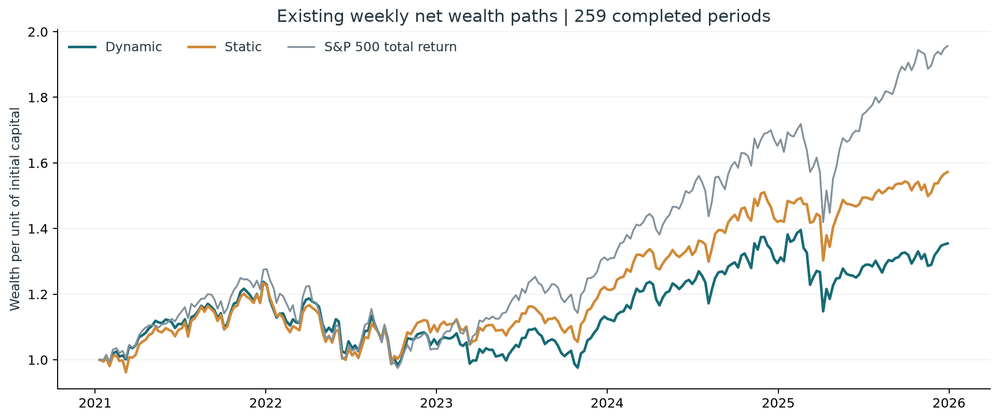
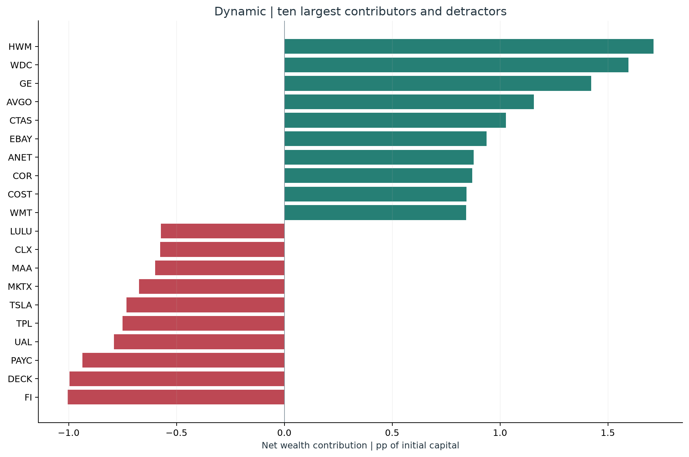
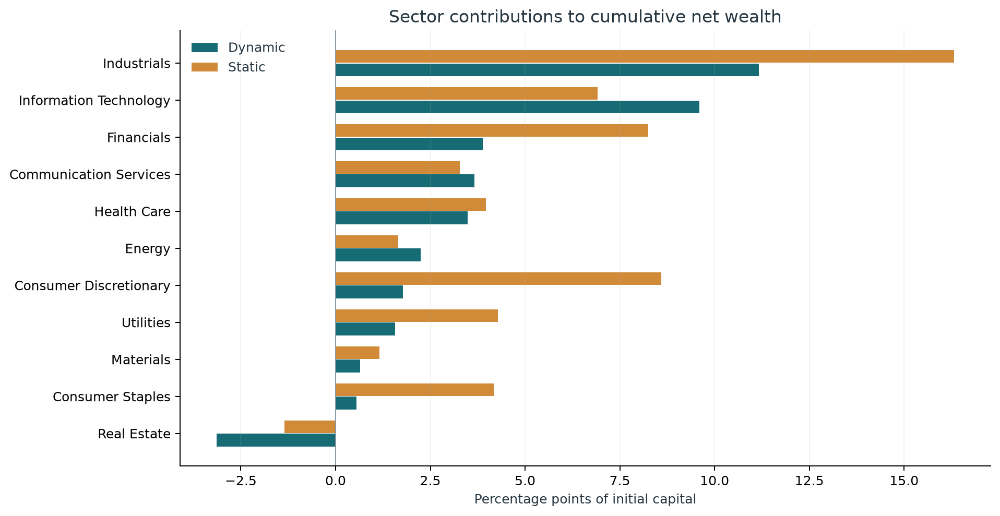
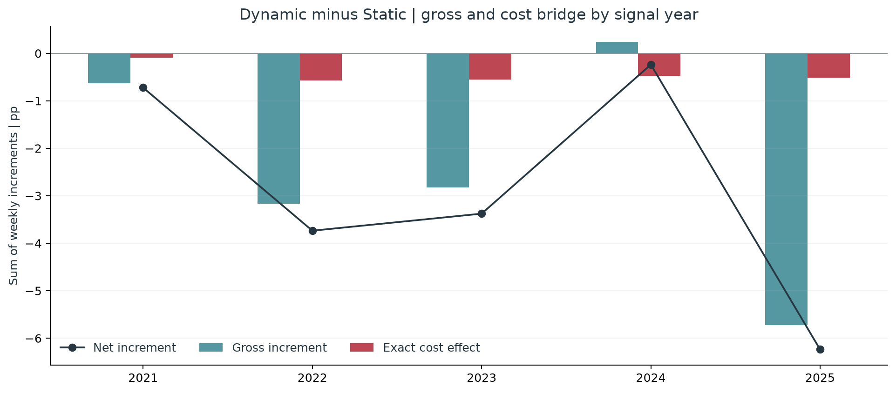
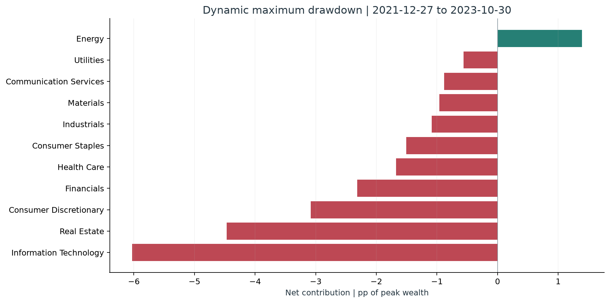
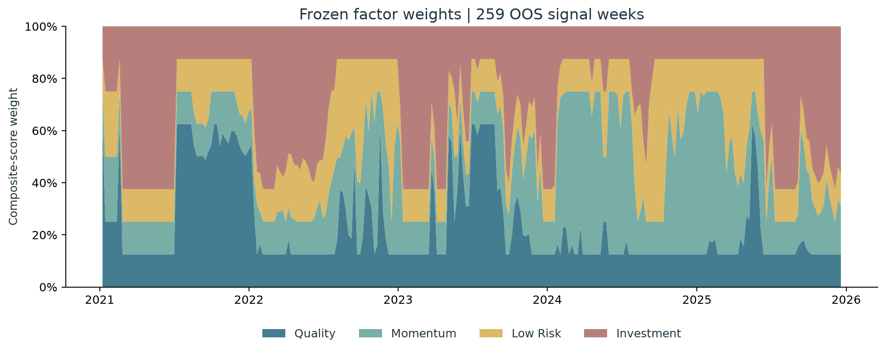
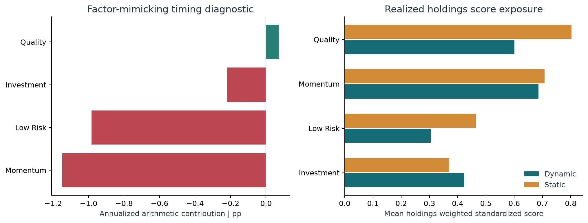
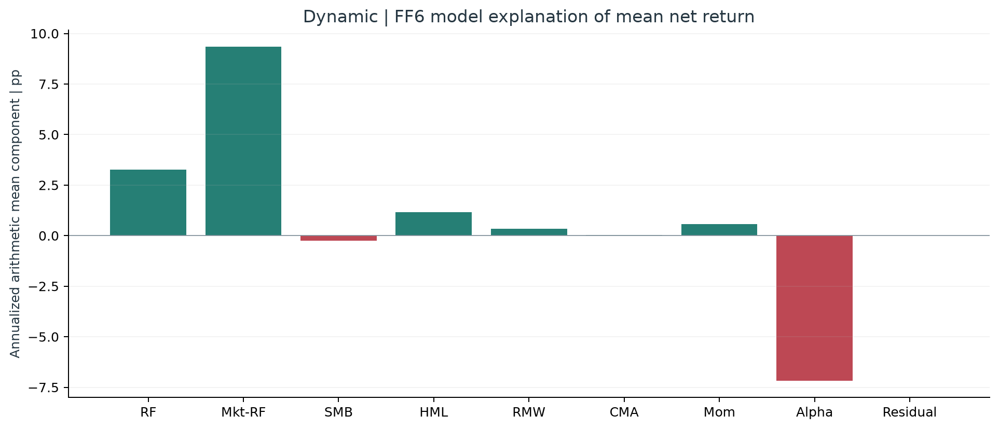

# 美股策略业绩归因报告

来源：member5-risk-analysis / 7b48586e45b1c456478c8a977e96043bc3108dad。研究对象：既有 Dynamic FMOM 与 Static Multi-Factor 周度回测。

## 1. 核心结论与结果边界

本报告基于 member5-risk-analysis 分支已提交的回测结果，分析 2021-01-08 至 2025-12-19 的 259 个信号周；持有期在 2021-01-11 至 2025-12-29 之间。最后一个跨入 2026 年的信号周未纳入。策略配置、持仓和交易均沿用 M4/M5，本工作只做解释、核对与会计分解。

动态策略累计净收益为 35.45%，静态策略为 57.23%；每投入 1 单位起始资本，动态策略期末少 0.2178 单位。对应的 CAGR 分别为 6.28% 与 9.51%，CAGR 差额为 -3.23 个百分点。

逐周净收益差的年化算术平均为 -2.87 个百分点，由毛收益差 -2.43 与精确成本影响 -0.44 个百分点闭合。HAC(4) p 值为 0.1249，95% 区间为 [-6.54, +0.80] 个百分点；样本点估计为负，不能据此认定总体增量在 5% 水平上显著为负。

正式解释限定在既有周度回测口径。M5 已披露的日频 NAV／周频 NAV 口径确认、最终团队签字和其他未关闭审计，仍属于上游待确认事项。

| 策略 | 累计净收益 | CAGR（52周年化） | Sharpe | 最大回撤 | 年换手 |
| --- | --- | --- | --- | --- | --- |
| Dynamic | 35.45% | 6.28% | 0.260 | 21.17% | 4.084 |
| Static | 57.23% | 9.51% | 0.470 | 19.86% | 1.874 |

初始资本归一化为 1；使用既有 259 周收益，未重建策略。

## 2. 归因口径与单位

每个信号日 S_t 对应下一交易日收盘 E_t 执行，个股持有期收益覆盖 (E_t, E_{t+1}]。股票用 PERMNO 关联，行业直接使用冻结持仓中的历史 GICS 并与同信号日股票池核对。现金收益为零。

逐周毛贡献：c_gross(i,t) = w(i,t) × r(i,t)。成本以执行前 NAV 为基数，TC_t 等于交易账本各股票成本之和；净收益严格按 R_net = (1−TC_t)(1+R_gross)−1 复核。

本报告逐股票净贡献采用“先扣成本再持有”的账本约定：c_net(i,t) = (1−TC_t)c_gross(i,t) − cost(i,t)。卖空仓位为零但发生卖出费用的证券也保留在表中。累计净贡献 = Σ_t NAV_net(t−1)c_net(i,t)，以起始资本为 1，所有股票与现金加总等于累计净收益。行业贡献是同一组股票贡献的聚合，两者不能重复相加。

报告中的“累计贡献百分点”指起始资本的百分比贡献，不是 CAGR 分解。年度表按 M5 的信号年份分组并在每年起点重新归一化，不是严格日历年收益。静态／动态收益差、因子模拟组合诊断、FF6 回归解释是不同视图，不能横向相加。美股均使用 USD，不增加独立的外汇换算贡献。

## 3. 个股 contributors 与 detractors

动态策略最大的正贡献证券是 HWM（+1.71 个起始资本百分点），最大的负贡献证券是 FI（-1.00 个百分点）。以下排名包含持有损益、扣成本后的资金影响及该股票发生的交易费用，不按单只股票原始涨跌幅排名。名称只作展示，证券身份始终由 PERMNO 决定，名称日期列表示样本内最后有效观察日。完整表还包括静态策略及所有证券。

| PERMNO | 历史代码 | 历史公司名 | 持有周数 | 累计净贡献（起始资本百分点） | 名称日期 |
| --- | --- | --- | --- | --- | --- |
| 24643 | HWM | HOWMET AEROSPACE INC | 114 | +1.71 | 2025-12-19 |
| 66384 | WDC | WESTERN DIGITAL CORP | 54 | +1.59 | 2025-12-19 |
| 12060 | GE | GENERAL ELECTRIC CO | 184 | +1.42 | 2025-12-19 |
| 93002 | AVGO | BROADCOM INC | 119 | +1.16 | 2025-12-19 |
| 23660 | CTAS | CINTAS CORP | 212 | +1.03 | 2025-06-20 |
| 86356 | EBAY | EBAY INC | 107 | +0.94 | 2025-12-19 |
| 14714 | ANET | ARISTA NETWORKS INC | 74 | +0.88 | 2025-03-07 |
| 81540 | COR | CENCORA INC | 149 | +0.87 | 2025-06-20 |
| 87055 | COST | COSTCO WHOLESALE CORP NEW | 147 | +0.85 | 2025-06-20 |
| 55976 | WMT | WALMART INC | 190 | +0.84 | 2025-12-19 |

| PERMNO | 历史代码 | 历史公司名 | 持有周数 | 累计净贡献（起始资本百分点） | 名称日期 |
| --- | --- | --- | --- | --- | --- |
| 10696 | FI | FISERV INC | 64 | -1.00 | 2025-10-31 |
| 79686 | DECK | DECKERS OUTDOOR CORP | 34 | -1.00 | 2025-06-06 |
| 14579 | PAYC | PAYCOM SOFTWARE INC | 55 | -0.94 | 2025-11-07 |
| 91103 | UAL | UNITED AIRLINES HOLDINGS INC | 21 | -0.79 | 2025-10-10 |
| 20391 | TPL | TEXAS PACIFIC LAND CORP | 35 | -0.75 | 2025-09-12 |
| 93436 | TSLA | TESLA INC | 8 | -0.73 | 2025-03-14 |
| 90454 | MKTX | MARKETAXESS HLDGS INC | 62 | -0.67 | 2025-06-13 |
| 80183 | MAA | MID AMERICA APT COMMUNITIES INC | 56 | -0.60 | 2025-06-20 |
| 46578 | CLX | CLOROX CO | 84 | -0.58 | 2025-09-12 |
| 92203 | LULU | LULULEMON ATHLETICA INC | 15 | -0.57 | 2025-06-06 |

名称为样本内最后一次观察到的有效历史名称；完整表保留 PERMNO 与名称日期。

## 4. 行业贡献与相对静态策略差额

先看动态策略本身的行业累计贡献，再看动态减静态的期末财富差额。后者把两套策略各自的净值路径连接后做差，全行业加总为 -21.78 个起始资本百分点。主要负差额来自 Consumer Discretionary, Industrials, Financials；Information Technology 的差额为正。正差额表示动态相对静态在该行业留下更多期末财富，并不表示该行业自身的股票都上涨。

有 1 个持仓／交易证券周缺少可核实的同信号日行业分类，保留 UNKNOWN 分类；其累计直接成本贡献为 -0.0010 个起始资本百分点。不使用当前行业或凭公司名补填。行业完整闭合包括 UNKNOWN 与现金。当前数据没有 S&P 500 成分股权重与行业收益接口，因此不把这些结果标为相对指数的 Brinson 配置／选择归因。

| 动态策略行业 | 全期平均权重 | 累计净贡献（百分点） |
| --- | --- | --- |
| Industrials | 17.37% | +11.17 |
| Information Technology | 16.68% | +9.59 |
| Financials | 15.05% | +3.89 |
| Communication Services | 5.31% | +3.67 |
| Health Care | 11.57% | +3.48 |
| Energy | 4.48% | +2.24 |
| Consumer Discretionary | 10.39% | +1.77 |
| Utilities | 4.82% | +1.57 |
| Materials | 3.67% | +0.65 |
| Consumer Staples | 5.91% | +0.55 |
| Real Estate | 4.74% | -3.14 |

| 行业 | 动态−静态期末财富差（百分点） |
| --- | --- |
| Consumer Discretionary | -6.83 |
| Industrials | -5.14 |
| Financials | -4.36 |
| Consumer Staples | -3.62 |
| Utilities | -2.71 |
| Real Estate | -1.79 |
| Materials | -0.51 |
| Health Care | -0.48 |
| Cash | +0.00 |
| Unknown | +0.00 |
| Communication Services | +0.39 |
| Energy | +0.59 |
| Information Technology | +2.69 |

各策略按自己的净值路径连接；加上现金／未知分类后分别加总至累计净收益，不是 CAGR 的分解。

## 5. FMOM 规则增量：选股结果与成本

两套策略的平均持仓重合率为 68.25%，Jaccard 为 52.42%。因此最终股票组合的增量应从共同持仓权重变化、动态独有持仓、静态独有持仓及卖出费用来解释，不能只用四个因子权重乘多空因子收益来代替。

2025 信号年是差额最差的一年：周度毛差额合计 -5.73 个百分点，成本影响 -0.51 个百分点，净差额合计 -6.24 个百分点。这些是周度差额的算术合计，与两条年度复合收益之差不同。

整个样本的期末财富桥为：毛路径差 -19.12，额外成本影响 -2.66，合计净路径差 -21.78 个起始资本百分点。该全期财富桥与前述年化平均差额使用不同单位，分别闭合。

| 信号年份 | 周数 | 动态复合净收益 | 静态复合净收益 | 毛差额合计（百分点） | 成本影响（百分点） | 净差额合计（百分点） |
| --- | --- | --- | --- | --- | --- | --- |
| 2021 | 52 | 18.15% | 18.83% | -0.63 | -0.09 | -0.72 |
| 2022 | 52 | -10.27% | -6.92% | -3.17 | -0.57 | -3.74 |
| 2023 | 52 | 5.84% | 9.63% | -2.83 | -0.55 | -3.38 |
| 2024 | 52 | 16.93% | 17.46% | +0.24 | -0.48 | -0.24 |
| 2025 | 51 | 3.23% | 10.40% | -5.73 | -0.51 | -6.24 |

| 全期财富桥 | 起始资本百分点 |
| --- | --- |
| 毛收益路径的期末财富差 | -19.12 |
| 动态额外成本的期末财富影响 | -2.66 |
| 净收益路径的期末财富差 | -21.78 |

| 历史代码 | 历史公司名 | 动态−静态期末财富差（百分点） |
| --- | --- | --- |
| RL | RALPH LAUREN CORP | -1.23 |
| EXPE | EXPEDIA GROUP INC | -1.11 |
| DECK | DECKERS OUTDOOR CORP | -0.94 |
| NRG | N R G ENERGY INC | -0.92 |
| FI | FISERV INC | -0.84 |
| APH | AMPHENOL CORP NEW | -0.78 |
| TSLA | TESLA INC | -0.73 |
| MNST | MONSTER BEVERAGE CORP NEW | -0.72 |
| FFIV | F 5 INC | -0.69 |
| COR | CENCORA INC | -0.60 |

| 历史代码 | 历史公司名 | 动态−静态期末财富差（百分点） |
| --- | --- | --- |
| MU | MICRON TECHNOLOGY INC | +0.72 |
| AVGO | BROADCOM INC | +0.69 |
| PARA | PARAMOUNT GLOBAL | +0.68 |
| DXC | D X C TECHNOLOGY CO | +0.68 |
| WBD | WARNER BROS DISCOVERY INC | +0.67 |
| RCL | ROYAL CARIBBEAN CRUISES LTD | +0.62 |
| TRGP | TARGA RESOURCES CORP | +0.61 |
| KMI | KINDER MORGAN INC | +0.56 |
| ADI | ANALOG DEVICES INC | +0.51 |
| AMD | ADVANCED MICRO DEVICES INC | +0.50 |

逐周差额的算术合计；按信号年份归组，不是两策略复合年收益的差。

## 6. 成本归因的精确闭合

“累计支付费用”是每周执行前净值乘 TC_t 后相加；“期末财富损失”还包括这些资金本可获得的后续收益，两者经济含义不同。期末毛／净财富差采用逐期精确递推计算，不能简单用所有周的成本率之和代替。两套策略均沿用单边 10bp，成本差来自既有交易路径与换手。归因没有重新选择成本参数。

| 策略 | 累计支付费用／初始资本 | 成本导致的期末财富差／初始资本 | 年换手 |
| --- | --- | --- | --- |
| Dynamic | 4.67% | 5.62% | 4.084 |
| Static | 2.28% | 2.96% | 1.874 |

## 7. 最大回撤的贡献来源

对每套策略各自的峰谷区间，以峰值资本重新归一化，逐周连接净贡献。只计峰值之后、谷值当期结束之前的持有期，不把到达峰值的前一期收益放进回撤。动态策略的最大回撤区间较静态策略长，因此两者各自回撤贡献表不用于直接比较同一市场窗口。

| 策略 | 峰值日 | 谷值日 | 恢复日 | 峰谷周数 | 峰谷收益 |
| --- | --- | --- | --- | --- | --- |
| Dynamic | 2021-12-27 | 2023-10-30 | 2024-06-17 | 96 | -21.17% |
| Static | 2021-12-27 | 2022-09-26 | 2024-01-22 | 39 | -19.86% |

| 动态回撤行业 | 峰值资本贡献（百分点） |
| --- | --- |
| Information Technology | -6.03 |
| Real Estate | -4.47 |
| Consumer Discretionary | -3.08 |
| Financials | -2.32 |
| Health Care | -1.67 |
| Consumer Staples | -1.51 |
| Industrials | -1.09 |
| Materials | -0.96 |
| Communication Services | -0.88 |
| Utilities | -0.56 |
| Cash | +0.00 |
| Energy | +1.39 |

| 历史代码 | 历史公司名 | 峰值资本贡献（百分点） |
| --- | --- | --- |
| IDXX | I D E X X LABORATORIES INC | -0.77 |
| TER | TERADYNE INC | -0.71 |
| SPG | SIMON PROPERTY GROUP INC NEW | -0.65 |
| STX | SEAGATE TECHNOLOGY HOLDINGS PLC | -0.63 |
| MKTX | MARKETAXESS HLDGS INC | -0.54 |
| ETSY | ETSY INC | -0.53 |
| MAA | MID AMERICA APT COMMUNITIES INC | -0.48 |
| BBY | BEST BUY COMPANY INC | -0.41 |
| SPGI | S & P GLOBAL INC | -0.41 |
| TROW | T ROWE PRICE GROUP INC | -0.38 |

以动态策略回撤起点资本重新归一化，各项加总至 −21.17% 的峰谷回撤。

## 8. 四因子权重、模拟组合择时与实际持仓暴露

主股票归因使用全部 259 周；四因子模拟组合择时诊断只用四个因子收益同时可用的 256 周，排除 3 周且不补收益。完全复用已提交的 M4 多空因子构造函数以及 M5 诊断口径。诊断年化平均增量为 -2.28 个百分点，平均横截面 rank IC 为 -0.0297，最高信号因子的胜出命中率为 21.48%。

Momentum 与 Low Risk 的模拟组合择时贡献为负，Quality 略为正；这些结果提供机制线索，不能加到股票收益上。实际股票组合中，动态的平均 Quality 与 Low Risk 分数暴露均低于静态，而 Investment 暴露较高。因子输入权重变化经过综合评分、排名、buffer 与行业约束后，未必转化为同方向、同幅度的持仓风格暴露变化。

| 因子 | 平均输入权重 | 高于25%的周比例 |
| --- | --- | --- |
| Investment | 31.90% | 46.33% |
| Low Risk | 18.76% | 17.76% |
| Momentum | 25.94% | 35.52% |
| Quality | 23.39% | 26.25% |

| 因子 | 完整周数 | 模拟组合择时年化贡献（百分点） |
| --- | --- | --- |
| Investment | 256 | -0.22 |
| Low Risk | 256 | -0.98 |
| Momentum | 256 | -1.15 |
| Quality | 256 | +0.07 |

| 策略 | 因子 | 平均持仓分数暴露 |
| --- | --- | --- |
| Dynamic | Investment | 0.422 |
| Dynamic | Low Risk | 0.304 |
| Dynamic | Momentum | 0.686 |
| Dynamic | Quality | 0.601 |
| Static | Investment | 0.370 |
| Static | Low Risk | 0.464 |
| Static | Momentum | 0.707 |
| Static | Quality | 0.803 |

这是选股评分的输入权重；不代表四个因子分别占有这些比例的策略损益。

左图仅用四因子均可用的 256 周，属于因子模拟组合诊断；右图是实际持仓暴露，两者均不可与股票贡献横向相加。

## 9. FF6 回归解释：独立于持仓损益视图

复用 M5 的 FF5 + Momentum 模型、执行区间聚合和 HAC(4) 推断，并逐项复现既有 alpha、p 值与 R²。市场因子先将日度市场总收益与 RF 分别复合，再相减；其他多空因子沿用 M5 的日收益复合近似，未重设聚合口径。模型中的市场、SMB、HML、RMW、CMA、Mom 与四个选股评分因子不是同一对象。

回归解释表中 RF + alpha + β×因子 + residual 每周加回净收益；其年化列是 52×周均解释项，不是可实现的各因子策略 CAGR，也不是因果 alpha。残差均值接近零来自 OLS 截距的代数性质。

| 模型 | 年化alpha | HAC p值 | R² |
| --- | --- | --- | --- |
| Dynamic FMOM | -7.19% | 0.0028 | 0.8624 |
| Static Multi-Factor | -3.74% | 0.1190 | 0.8536 |
| Dynamic - Static | -3.44% | 0.0610 | 0.0817 |

| 动态模型解释项 | 年化均值贡献（百分点） |
| --- | --- |
| Alpha | -7.19 |
| CMA | +0.04 |
| HML | +1.16 |
| Mkt-RF | +9.34 |
| Mom | +0.57 |
| RF | +3.27 |
| RMW | +0.34 |
| Residual | -0.00 |
| SMB | -0.24 |

完全复用 M5 的执行区间聚合与 HAC(4) 口径；这是事后模型解释，不是四个选股因子的实际损益分摊。

## 10. 数据缺口、核验与复现

数值验收中所有关键项通过，闭合检查的最大绝对误差为 9.714e-15。核验覆盖输入 LFS 哈希、持仓／收益联结、下一收盘执行时点、历史行业、权重、交易漂移、成本、逐周毛净收益、全期财富、行业汇总、回撤、M5 绩效与 FF6 复现，以及输入前后哈希不变。

冻结回测在动态和静态中各有 4 个证券周使用不可用收益按 0 计的既有规则，合计 8 条。本报告保留这些行、原始不可用原因和权重；这是解释已交付回测的条件，不能视为这些证券当周真实收益已被验证为零。完整清单见下表和 unpriced_holdings.csv。

结果仅覆盖既有 2021–2025 周度历史样本外路径。未改动四因子、FMOM、持仓、交易、成本参数或任何上游结果，也没有用这些结果重新选策略。source_contract.json、input_manifest.csv、run_manifest.json、qa_checks.csv、output_manifest.csv 和运行脚本共同构成复核链条。

| 策略 | 信号日 | PERMNO | 受影响权重 | 上游不可用原因 |
| --- | --- | --- | --- | --- |
| Dynamic | 2021-12-17 | 91461 | 1.00% | INVALID_EXECUTION_CLOSE_OR_NOT_INVESTABLE |
| Dynamic | 2022-09-30 | 75341 | 1.01% | INVALID_EXECUTION_CLOSE_OR_NOT_INVESTABLE |
| Dynamic | 2023-03-17 | 60599 | 1.01% | INVALID_EXECUTION_CLOSE_OR_NOT_INVESTABLE |
| Dynamic | 2024-07-05 | 21186 | 1.01% | INVALID_EXECUTION_CLOSE_OR_NOT_INVESTABLE |
| Static | 2022-02-25 | 14704 | 1.00% | INVALID_EXECUTION_CLOSE_OR_NOT_INVESTABLE |
| Static | 2022-09-30 | 75341 | 1.01% | INVALID_EXECUTION_CLOSE_OR_NOT_INVESTABLE |
| Static | 2024-06-21 | 52230 | 1.01% | INVALID_EXECUTION_CLOSE_OR_NOT_INVESTABLE |
| Static | 2024-07-05 | 21186 | 1.01% | INVALID_EXECUTION_CLOSE_OR_NOT_INVESTABLE |
